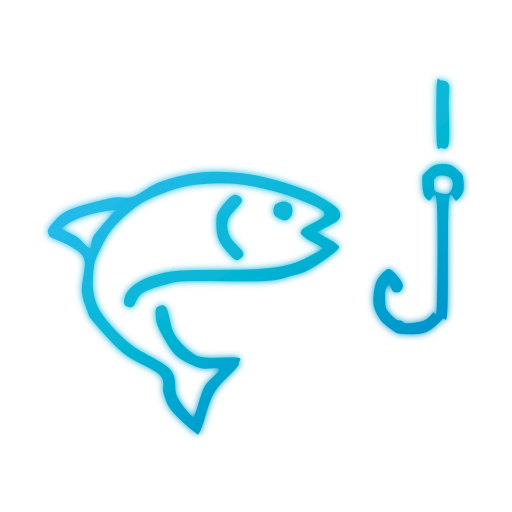

# 🐟 FishFlow

<p align="center">
  
</p>

<h3 align="center">Modern, Self-Hosted Maritime Weather & Solunar Fishing Activity Forecast Platform</h3>

<p align="center">
  <em>High-precision solunar theory, barometric pressure derivatives, 24-hour harmonic tides, wave conditions, interactive nautical satellite maps, and real-time weather — 100% free, private, and containerized for your homelab.</em>
</p>

<p align="center">
  <a href="#-key-features"></a>
  <a href="LICENSE"></a>
  <a href="#-quickstart-with-docker-compose"></a>
  <a href="#-local-development"></a>
  <a href="#-local-development"></a>
</p>

---

## 📖 Table of Contents

- [Overview](#-overview)
- [Key Features](#-key-features)
- [Scoring Algorithm](#-scientific-solunar-scoring-algorithm)
- [Architecture](#-architecture)
- [Installation & Deployment](#-installation--deployment)
  - [Method 1: From GitHub Release (Recommended for Homelab)](#method-1-from-github-release-recommended-for-homelab)
  - [Method 2: From Source with Git (Developers)](#method-2-from-source-with-git-developers)
- [Homelab Reverse Proxy Configuration](#-homelab-reverse-proxy-configuration)
- [Local Development](#-local-development)
- [API Reference](#-api-reference)
- [Technology Stack](#-technology-stack)
- [License](#-license)

---

## 🌊 Overview

**FishFlow** was built to provide anglers, boaters, and marine enthusiasts with an open, self-hosted alternative to expensive commercial fishing forecast apps. 

Commercial alternatives often lock basic solunar data behind costly monthly subscriptions, flood screens with intrusive ads, track user locations, and hardcode inaccurate rules of thumb. 

FishFlow runs entirely on your own infrastructure (such as a Raspberry Pi, NAS, or homelab server), queries public open meteorological APIs (**Open-Meteo**), computes astronomical ephemerides locally using **PyEphem**, and presents everything through a responsive, modern web interface.

---

## ✨ Key Features

- **🎯 Scientific Solunar & Barometric Activity Score (0–100)**:
  - Real-time fishing index calculated with calibrated astronomical and meteorological weightings.
  - Automatically locates **Major Activity Windows** (±75 min around Moon Zenith/Nadir) and **Minor Activity Windows** (±45 min around Moonrise/Moonset).
  - Evaluates 3-hour barometric pressure tendencies ($\Delta P = P_t - P_{t-3}$) to reward pre-frontal feeding triggers.
- **📊 24-Hour Continuous Activity Wave Curve**:
  - High-precision harmonic activity curve displaying predicted feeding windows.
  - Live animated cyan marker indicating current status and score.
- **🌊 Harmonic Tides & Marine Conditions**:
  - 241-point continuous harmonic tide curve with next high/low tide predictions, vertical guide lines, and current water level.
  - Sea surface temperature (°C), current velocity and compass direction, wave height (m), wave period (s), and direction.
  - Intelligent fallback for inland waters, rivers, and lakes.
- **🌤️ Synchronized 24h Hourly Weather & Wind Timeline**:
  - Exact X-axis time alignment (`00:00` to `23:00`) with zero drift.
  - Multi-metric toggle: Temperature (°C), Rain Probability & Precipitation (mm/h), Wind Speed (kn & m/s), and Surface Pressure (hPa).
  - Aerodynamic vector wind turbine anemometer with compass direction and gust warnings.
- **🌓 Sun & Moon Ephemeris Dashboard**:
  - 24-hour circular solar dial indicating day/night duration, solar noon, dawn, sunrise, sunset, and dusk.
  - Moon phase visualization with illuminated percentage, distance in kilometers, age in days, moonrise, and moonset.
- **🧭 Interactive Nautical Map with Tape Compass**:
  - Integrated Leaflet map with high-definition **Esri World Imagery** satellite tiles.
  - Real-time top tape compass indicating heading and bearing angles.
  - Tap-to-inspect coordinate anywhere in the world to get instant forecasts and save spots.
- **⭐ Saved Spots & Fast Geolocation**:
  - Client-side storage via `localStorage` — no external accounts or databases required.
  - Instant browser GPS geolocation with graceful IP-based fallback.
- **📱 100% Dynamic Responsive Multi-Device UI**:
  - Seamless layout adapted for mobile smartphones (touch navigation), tablets, and dual-column desktop/laptop dashboards.
  - Zero forced scrolling on standard 1080p and laptop screens.
- **🌐 Bilingual Internationalization (i18n)**:
  - One-click language switcher supporting **English (EN)** and **Italian (IT)** with persistent settings.
- **🔒 100% Free & Privacy-First**:
  - Zero API keys required, zero third-party tracking, zero telemetry.

---

## 🧮 Scientific Solunar Scoring Algorithm

FishFlow combines celestial mechanics and atmospheric physics into a composite index ($0 - 100$):

$$\text{Activity Score} = 0.35 \times S_{\text{solunar}} + 0.35 \times S_{\text{pressure}} + 0.15 \times S_{\text{light}} + 0.15 \times S_{\text{weather}}$$

| Component | Weight | Determinant Factors |
| :--- | :---: | :--- |
| **Solunar Component ($S_{\text{solunar}}$)** | **35%** | Moon phase (New Moon & Full Moon peak), Perigee / Supermoon distance bonus, Moon transit elevation (Zenith & Nadir peaks). |
| **Barometric Derivative ($S_{\text{pressure}}$)** | **35%** | 3-hour pressure derivative ($\Delta P = P_t - P_{t-3}$). Gradual drops ($-1.0$ to $-3.0$ hPa) stimulate active predatory feeding; sharp rises or post-frontal spikes cause apathy. |
| **Twilight & Light ($S_{\text{light}}$)** | **15%** | Astronomical sun elevation angle. Golden hour boost ($+25\%$) during civil and nautical twilight (sun between $-8^\circ$ and $+6^\circ$). |
| **Wind & Cloud Cover ($S_{\text{weather}}$)** | **15%** | Surface water ripple (optimal at $4 - 12\text{ kn}$); overcast glare reduction bonus; storm/lightning penalty. |

### Qualitative Ratings

- **75 – 100**: **Excellent** / *Eccellente*
- **55 – 74**: **Good** / *Buona*
- **38 – 54**: **Average** / *Media*
- **23 – 37**: **Low** / *Bassa*
- **0 – 22**: **Very Low** / *Molto bassa*

---

## 🏛️ Architecture

```
                      Client (Browser / Mobile)
                                 │
                                 ▼
                     ┌───────────────────────┐
                     │   Reverse Proxy       │ (Port 80/443 - NPM / Caddy / Traefik)
                     └───────────┬───────────┘
                                 │
                    Forward to Host Port 8080
                                 │
     Docker Network: fishflow-net│
     ┌───────────────────────────┴────────────────────────────┐
     │                                                        │
     │  ┌───────────────────────────┐                         │
     │  │ fishflow-frontend:80      │ (Exposes Port 8080:80)  │
     │  │ • Nginx Alpine            │                         │
     │  │ • Vue 3 + Vite SPA (HTML5)│                         │
     │  │ • Internal proxy for /api │                         │
     │  └─────────────┬─────────────┘                         │
     │                │ Transparent Proxy Pass (/api/*)       │
     │                ▼                                       │
     │  ┌───────────────────────────┐                         │
     │  │ fishflow-backend:8000     │ (Internal Network Only) │
     │  │ • FastAPI (Python 3.12)   │                         │
     │  │ • PyEphem Engine (Offline)│                         │
     │  │ • Open-Meteo HTTP Client  │                         │
     │  └───────────────────────────┘                         │
     │                                                        │
     └────────────────────────────────────────────────────────┘
```

---

## 🚀 Installation & Deployment

### Prerequisites
- Docker Engine 24+ and Docker Compose v2+ installed on your server or machine.

---

### Method 1: From GitHub Release (Recommended for Homelab)

Ideal for self-hosters and servers (Portainer, Dockge, CasaOS, Unraid, TrueNAS, Raspberry Pi). You don't need to clone the entire Git repository or development history.

1. **Download and extract the latest release archive**:
   ```bash
   # Create application directory
   mkdir -p fishflow && cd fishflow

   # Download and extract the latest release package
   curl -sL https://github.com/DreadPirateNear/fishflow/archive/refs/tags/v1.0.0.tar.gz | tar -xz --strip-components=1
   ```

2. **Configure Port (Optional)**:
   ```bash
   cp .env.example .env
   # Edit FISHFLOW_PORT in .env if desired (default is 8080)
   ```

3. **Launch the stack**:
   ```bash
   docker compose up -d
   ```

   The web interface is immediately available at `http://localhost:8080` (or `http://your-server-ip:8080`).

---

### Method 2: From Source with Git (Developers)

For developers who want to inspect the source code or contribute:

```bash
# Clone the repository
git clone https://github.com/DreadPirateNear/fishflow.git
cd fishflow

# Optional environment setup
cp .env.example .env

# Build and start container stack
docker compose up -d --build
```

Access the application in your browser:
```
http://localhost:8080
```

---

## 🌐 Homelab Reverse Proxy Configuration

### Nginx Proxy Manager (NPM)
1. Add a new **Proxy Host**.
2. **Domain Names**: `fishing.yourdomain.com` (or local domain `fishflow.home.arpa`).
3. **Forward Hostname / IP**: Server host IP (e.g. `192.168.1.100`).
4. **Forward Port**: `8080`.
5. Enable **Websockets Support** and **Block Common Exploits**.
6. (Recommended) Generate a Let's Encrypt SSL certificate.

### Caddy
```caddy
fishing.yourdomain.com {
    reverse_proxy 127.0.0.1:8080
}
```

### Traefik
```yaml
services:
  fishflow-frontend:
    labels:
      - "traefik.enable=true"
      - "traefik.http.routers.fishflow.rule=Host(`fishing.yourdomain.com`)"
      - "traefik.http.services.fishflow.loadbalancer.server.port=80"
```

---

## 🛠️ Local Development

### Backend (Python 3.12+)
```bash
cd backend
python -m venv .venv
source .venv/bin/activate  # On Windows: .venv\Scripts\activate
pip install -r requirements.txt

# Run pytest test suite
pytest tests/ -v

# Run local development server
uvicorn app.main:app --reload --port 8000
```

### Frontend (Node.js 20+)
```bash
cd frontend
npm install

# Start Vite dev server with hot reload
npm run dev

# Build production bundle
npm run build
```

---

## 📡 API Reference

The backend provides a documented REST API:

| Endpoint | Method | Description |
| :--- | :---: | :--- |
| `/health` | `GET` | Health check probe (`{"status": "healthy"}`) |
| `/api/v1/forecast` | `GET` | Detailed 24h solunar, marine, and weather forecast for latitude/longitude |
| `/api/v1/forecast/summary` | `GET` | 7-day or 14-day summary forecast for date carousel |
| `/api/v1/search` | `GET` | Location autocomplete search for spots and cities |
| `/api/v1/reverse-geocode` | `GET` | Reverse geocode coordinates to spot name & marine status |
| `/api/v1/location/auto` | `GET` | Automatic IP-based location fallback |

Interactive OpenAPI documentation is available at:
```
http://localhost:8000/docs
```

---

## 💻 Technology Stack

- **Backend**: [FastAPI](https://fastapi.tiangolo.com/), [Python 3.12](https://www.python.org/), [PyEphem](https://rhodesmill.org/pyephem/), [HTTPX](https://www.python-httpx.org/), [Pydantic v2](https://docs.pydantic.dev/).
- **Frontend**: [Vue.js 3 (Composition API)](https://vuejs.org/), [Vite](https://vitejs.dev/), [Tailwind CSS](https://tailwindcss.com/), [Chart.js](https://www.chartjs.org/), [Leaflet](https://leafletjs.com/), [Lucide Icons](https://lucide.dev/).
- **Deployment**: [Docker](https://www.docker.com/), [Docker Compose](https://docs.docker.com/compose/), [Nginx Alpine](https://nginx.org/).
- **Data Providers**: [Open-Meteo Weather & Marine API](https://open-meteo.com/), [Esri World Imagery](https://www.esri.com/).

---

## 📄 License

This project is licensed under the **MIT License** — see the [LICENSE](LICENSE) file for details.
Free and open-source for anglers and enthusiasts worldwide.
